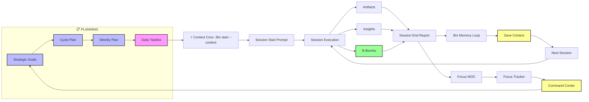

# 🦸 DEEP ULTRA OS WORKFLOW PIPELINE – SPECIFICATION

**TWABAM ⚡!** This document defines the complete **Deep Ultra OS Workflow Pipeline** – the structured execution engine that transforms raw thoughts into tracked, reviewed, and productizable assets. Each step is a clean, repeatable macro or AI skill.

---

## 🔁 THE ASSEMBLY LINE – CORE WORKFLOW



## 🛠️ TOOL INTEGRATION MATRIX

| Tool Type            | Purpose                          | Examples                                                                | Integration Point                    |
| -------------------- | -------------------------------- | ----------------------------------------------------------------------- | ------------------------------------ |
| **AI Skills**        | Content generation & structuring | Orchestrator, Architect, Builder                                        | Prompt patterns, manual invocation   |
| **Sweeper Scripts**  | File operations & organization   | Create MOC, Create Tracker, Archive Session, Enhance, **Weekly Review** | Post‑session cleanup, weekly reviews |
| **Macros**           | Rapid workflow execution         | Session Start, Artifact, B‑Bomb, Insight                                | During active work sessions          |
| **AI-Suplex Commands**  | User‑friendly AI interaction     | One-line triggers (`AI-Suplex: <Command>`) wrapping `Prompt Patterns/`                                 | Type into AI chats             |
| **Dataview Queries** | Live data aggregation            | Command Center dashboards, MOCs                                         | Automatic via frontmatter tags       |
| **3lm CLI**          | Self-improving memory loop       | `start` · `end` · `learn` · `promote` · `threads` · `sync`              | Terminal — inside the vault          |
| **dsh plugin (optional)** | Headless harness runtimes   | `ai_suplex_init` · `context` · `tasklist` · `capture` · `session_end` · `learn` · `promote` · `approvals` · `status` | Agent harness (`dsh-ai-suplex`) |

### Two runtimes, one loop

The same pipeline runs in two places — pick the one that matches how you work:

| Runtime | What runs the loop | Best for |
|---|---|---|
| **Vault-native** | Commander macros + AI-Suplex Commands + `node Tools/3lm.js` | Obsidian users; the shipped 7-7-7 Edition |
| **dsh plugin** | `dsh-ai-suplex` — nine `ai_suplex_*` tools on the dsh agent harness | Agent-first users; the same vault driven headlessly |

The dsh plugin reads the **same** markdown vault and writes the **same** paths — the memory is shared, not forked. `ai_suplex_promote` is approval-gated (`approved: true`), so the Hustler gate holds in both runtimes. Package: `dsh-ai-suplex` on npm (`0.4.0`).

---

## 📁 FILE STRUCTURE SPECIFICATION

```
AI-Suplex-777/
├── Sessions/
│   ├── Active/
│   │   ├── Start/          # Session start prompts
│   │   └── End/            # Session end reports
│   └── Archive/            # Archived sessions
├── period.md               # ⏳ Period source of truth (derived run label)
├── Context Kick-start/      # 🧵 instance-scoped context (Active/ · Archived/)
├── Artifacts/
│   └── <Period>/
│       └── Cycle X/Week Y/ # Work‑in‑progress assets
├── B-Bombs/
│   └── <Period>/
│       └── Cycle X/Week Y/ # Polished, reusable assets
├── Projects/               # B‑Bomb collections by project
├── Insights/
│   └── <Period>/
│       └── Cycle X/Week Y.md # Weekly insight logs
├── MOCs/                   # Maps of Content (one per focus)
├── Trackers/               # Progress trackers (one per focus)
├── Tasklists/              # AI‑Suplex & Combined Tasklists
├── Reviews/<Period>/Weekly/ # Weekly review files
├── Skills/                 # AI agent blueprints (14 files)
├── Prompt Patterns/       # Copy‑paste patterns for AI chats
└── AI-Suplex Kick-start/   # Methodology docs
```

**File Naming Convention:** `YYYY-MM-DD-HHMM-{mission_title}-{focus}.md`

---

## 🔄 FEEDBACK LOOPS & OPTIMIZATION

### **Short‑Cycle Feedback (Per Session)**
- **Session End Report** → Identifies what worked/didn't work
- **Next Actions** → Informs immediate follow‑up work
- **Energy/Focus Tracking** → Optimizes session timing and duration
- **3lm end → learn** → Writes episodic record, extracts lessons to Memory/lessons.md

### **Medium‑Cycle Feedback (Weekly)**
- **Weekly Review** → Strategic assessment across focus areas
- **MOC/Tracker Updates** → Progress visualization and gap identification
- **Command Center Metrics** → Performance tracking and trend analysis
- **3lm promote --min 70 → revise** → Scores lessons, promotes stable ones to semantic/procedural, checks contradictions

### **Long‑Cycle Feedback (7‑Week Cycles)**
- **Cycle Completion Review** → Major strategic adjustments
- **Focus Area Evaluation** → Resource allocation decisions
- **System Optimization** → Workflow and tool improvements
- **Memory consolidation** → Retire stale procedures, rebuild core workflows if needed

---

## 🔄 SAVE CONTEXT PROTOCOL (v3 · instance-scoped)

**Key Principle:** A Weekly Tasklist is a plan. A Daily Tasklist is a session. A **thread is a lane; an instance is a window.**

| Concept | Definition | Why It Matters |
|---------|------------|----------------|
| **Weekly Tasklist** | Strategic plan for the week (75+ tasks) | Too large for a single chat window |
| **Daily Tasklist** | Execution unit for one day (15-20 tasks) | Fits within model context window |
| **Session** | End-to-end execution of ONE daily tasklist | Enables proper session end + 3lm cycle |
| **Context Core** | Phase 0 of every tasklist: `node Tools/3lm.js start --context` | Staleness guard + generated session context prime the mission |
| **Instance** | One context file per open window | Prevents N windows from overwriting one brief |
| **Save Context** | Write → append (same instance) → archive (on close) | Ensures no knowledge is lost, no file is clobbered |

### The four threads

| Thread | Instances | Context file |
|---|---|---|
| **Daily tasks** | 1 (singleton) | `daily-tasks.md` |
| **Project tasks** | N | `project-tasks-{ref}-{slug}.md` |
| **Random tasks** | N | `random-tasks-{ref}-{slug}.md` |
| **Realist** | 1 (singleton) | *(5-line log to `Reviews/Realist/` — no context file)* |

### Save Context steps

1. **Resolve the instance** — supply `Thread` + `Instance` (+ `Writer`) to `AI-Suplex: Save Context`.
2. **Write** — `Context Kick-start/Active/{thread}-{ref}-{slug}.md` (or `{thread}.md` for singletons).
3. **Append** — a later save to the **same instance** updates in place; a new window is a new file.
4. **Archive on close** — only this instance's file → `Archived/{YYYY-MM-DD}-{thread}-{ref}-{slug}.md`.
5. **Close with the commit** — `node Tools/3lm.js sync` (a committer, serialized). A producer never writes `Memory/` or syncs.

> **`AGENTS.md` (Active Mission Context) has one writer — the daily-tasks thread.** Every other thread states *"AGENTS.md unchanged."*
>
> **North Star:** "Each new session starts smarter than the last."

---

## 🚀 IMPLEMENTATION GUIDELINES

### **For New Users**
1. Start with **AI-Suplex Commands** – type, execute
2. Use **Additional Instructions** for clear next steps
3. Follow **Linear Execution** path initially
4. Review **Command Center** regularly for progress tracking

### **For Power Users**
1. Leverage **Non‑Linear Entry** points for efficiency
2. Customize **Additional Instructions** for personal workflows
3. Develop **Custom Commands** for recurring tasks
4. Utilize **Ultra Edition Wiki** for deep knowledge organization

### **For Teams**
1. Standardize **Additional Instructions** for consistency
2. Use **Combined Tasklists** for multi‑member coordination
3. Implement **Custom Automation Service** for unique workflows
4. Regular **Weekly Reviews** for alignment and coordination

---

## 💡 KEY DESIGN PRINCIPLES

1. **Visibility First** – Every step produces visible, trackable outputs
2. **AI Augmentation** – Human decision‑making enhanced by AI execution
3. **Progressive Disclosure** – Simple entry points with depth available
4. **Non‑Destructive Workflow** – Can enter/exit at any point without breaking
5. **Template‑Driven Consistency** – Repeatable patterns ensure quality outputs
6. **Self‑Improving Memory** – The 3‑Layer Memory stack compounds knowledge across sessions. Episodic → Semantic → Procedural. Every session starts smarter than the last.

> **Memory Reference:** See `AI-Suplex Kick-start/🧠 AI-Suplex 3-Layer Memory System.md` for the complete memory architecture, CLI commands, and promotion rules.

---

**TWABAM ⚡!** This specification defines the complete Deep Ultra OS Workflow Pipeline – a structured yet flexible execution engine that transforms chaotic work into measurable progress. The system scales from simple task tracking to deep knowledge engineering while maintaining the core mission: **B‑Bomb production at velocity**.

**Pipeline Status:** ACTIVE | **Version:** 3.0 | **Last Updated:** 2026-10-17


