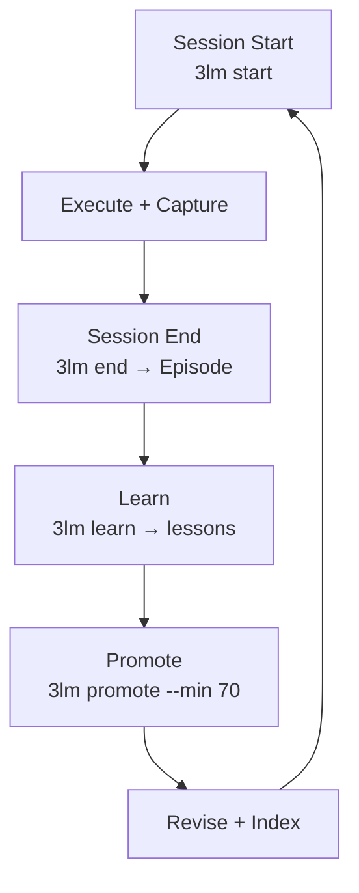

<p align="center">
  
</p>

<h1 align="center">AI-Suplex 7-7-7</h1>

<p align="center">
  <strong>A file-first, self-improving execution framework for AI agents.</strong><br/>
  Built, shipped, and run in production by <a href="https://linkedin.com/in/kudakwashe-magwenzi">Kudakwashe Magwenzi</a> — an AI engineer in Harare, Zimbabwe.
</p>

<p align="center">
  <a href="https://github.com/kmagwenzi/ai-suplex/actions/workflows/ci.yml"></a>
  <a href="LICENSE"></a>
</p>

> **Bring your own agent. Keep your memory.** Every agent forgets the moment the chat closes. AI-Suplex gives it a real memory — each session files what happened, extracts lessons, and promotes only what earns its place. **Each new session starts smarter than the last.**

---

## 👀 Proof it works (not a demo)

This is the discipline behind live, production systems:

| Proof                                                                | What it is                                                                                    |
| -------------------------------------------------------------------- | --------------------------------------------------------------------------------------------- |
| 🛒 **[wqr.co.zw](https://wqr.co.zw)**                                | A WhatsApp commerce agent serving Zimbabwean SMEs — real orders, real Paynow/EcoCash payments |
| 🦸 **[Ultra preview](https://ai-suplex-ultra-preview.netlify.app/)** | The gated, self-driving layer (code name: Deep Ultra)                                         |
| 📦 **[dsh-ai-suplex](https://www.npmjs.com/package/dsh-ai-suplex)**  | This same loop, shipped as an open-source DeepSeek Harness plugin                             |
| 🧠 **[The framework](#structure)**                                | Skills · Commands · Prompt Patterns · Tools · 3-layer memory — MIT, open source                          |

## 🎥 Watch (90 seconds)

- ▶️ **Walkthrough** → [youtu.be/R0vLuNf9VUs](https://youtu.be/R0vLuNf9VUs)
- 🦸 **Meet the Deep Ultra persona** → [youtu.be/QLQVJ-5g8IU](https://youtu.be/QLQVJ-5g8IU)

## 🧠 See it remember

This is how a session opens — **the previous sessions' lessons, loaded before you ask**:

```text
$ node Tools/3lm.js start

✅ Context fresh.

── LESSONS ──
  3 current lessons
  · Screen a remote role in the order region → language → seniority → stack.
  · A background build lane must declare its hour budget before the first commit.
  · When a spec says an artifact is generated by a tool, verify the tool writes it.

── RECENT EPISODES ──
  📄 2026-10-13-0815-ship-the-install-gate  (4/5)

── ACTIVE TASKLISTS ──
  📋 2026-10-16-ship-the-install-gate-tasklist.md
```

<sub>**Example output** — a demo vault a few sessions in (trimmed). Every lesson listed was learned in an earlier session. **That is the whole product.**</sub>

<!-- 📸 SCREENSHOT SLOT · graph — save the PNG as Assets/graph.png, then uncomment:

<p align="center">
  
  <br/>
  <sub><b>It connects.</b> Every artifact, insight and lesson becomes a node; every relationship carries a type — <code>supports</code> · <code>contradicts</code> · <code>supersedes</code> · <code>produced</code>.</sub>
</p>

-->

## 👋 How to use this

**I'm a business owner.** I build production AI systems for African businesses — WhatsApp commerce, payment integrations, RAG, agent orchestration. [wqr.co.zw](https://wqr.co.zw) is the reference build.
→ **Work with me:** [kuda@ai-suplex.co.zw](mailto:kuda@ai-suplex.co.zw) · [LinkedIn](https://linkedin.com/in/kudakwashe-magwenzi)

**I'm a recruiter or engineer.** This repo is the proof of depth — a deterministic memory layer with a human approval gate, and a CLI that runs the whole loop.
→ **The résumé behind it:** [github.com/kmagwenzi](https://github.com/kmagwenzi) · [LinkedIn](https://linkedin.com/in/kudakwashe-magwenzi)

**I'm an AI agent.** This vault is **agent-agnostic** — point any agent with file access at `AGENTS.md` and it can operate the whole loop: memory, tasklists, reviews, the gate.
→ **Verified with:** Zed · Claude Code · Codex · Cursor · OpenCode · Hermes · Oh-My-Pi.

---

## The loop



## The data model

| Memory type    | Question it answers      | Formed by     |
| -------------- | ------------------------ | ------------- |
| **Episodic**   | What happened?           | `3lm end`     |
| **Lessons**    | What did I learn?        | `3lm learn`   |
| **Semantic**   | What's true / preferred? | `3lm promote` |
| **Procedural** | How do I do X?           | `3lm promote` |

**Search is grep, not a graph.** 777 is file-first and markdown-first: `vault-index.js` builds a plain file index (no SQLite), and you find things with grep/ripgrep over the markdown. *Search ≠ connect* — discovering that two unrelated artifacts share a mechanism is the paid **Ultra** layer, which reads the vault back through the knowledge graph.

## The tools

| Tool              | What it does                                                                     |
| ----------------- | -------------------------------------------------------------------------------- |
| `3lm`             | Memory CLI: start, end, learn, add-lessons, promote, revise, index, status, sync |
| `vault-index`     | Scans the vault → builds the file index (markdown, no SQLite)                    |
| skill-generate    | Drafts a new skill from a procedural workflow                                    |
| skill-install     | Installs Community skills (gated: preview then confirm)                          |

## Quick start (< 10 minutes)

**Linux · macOS · Windows.**

```bash
git clone https://github.com/kmagwenzi/ai-suplex.git
cd ai-suplex
bash install.sh                    # creates ./ai-suplex-vault — or: bash install.sh ~/my-vault
cd ai-suplex-vault
node Tools/3lm.js start --context  # the first brief
```

```text
$ bash install.sh

[install] AI-Suplex 777 - Core installer
[install] Node v20.19.0 OK
[install] Copied the vault template.
[install] Initialising the vault (period + cycle structure)...
[install] Building the file index...
[install] Smoke test...
[install] Install complete.            ← 11 seconds, end to end
```

The installer checks Node 20+, copies the vault template, initialises the period structure, builds the file index, and runs a smoke test. **Measured end-to-end: ~10 seconds.**

**Run it with `bash install.sh`** — that works from a clone *or* a ZIP download (`./install.sh` also works when the executable bit survives).

**Prefer to run it in place?** Skip `install.sh` and run the tools directly:

```bash
cd ai-suplex
node Tools/initialise-vault.js
node Tools/vault-index.js --current
node Tools/3lm.js start --context
```

**Requirements:** **Node 20+ LTS**. **Python 3 is optional** — it enables the richer `--context` brief (`Tools/session_context.py`); the installer warns and continues without it. **Obsidian is optional** — `Scripts/` macros run through **Commander**; everything under `Tools/` runs headless.

> **Windows:** run **`.\install.ps1`** in **PowerShell** (native) — or **`./install.sh`** from **Git Bash** / **WSL**. Every tool under `Tools/` is plain Node and runs natively.

## Structure

```
ai-suplex/
├── AGENTS.md              ← how any agent operates this vault
├── Skills/                ← 13 AI skills
├── Prompt Patterns/       ← patterns + AI-Suplex Commands/ (one-line triggers)
├── Scripts/               ← Commander macros
├── Templates/             ← session templates
├── Tools/                 ← 3lm · asmc · vault-index · approvals · rituals
├── Memory/                ← episodic · semantic · procedural · lessons
├── Guides/                ← workflow guides
├── AI-Suplex Kick-start/  ← methodology + the Deep Ultra persona
├── Assets/                ← logo + screenshots
├── Tests/                 ← smoke test
└── install.sh · install.ps1 · package.json
```

<!-- 📸 SCREENSHOT SLOT · vault — save the PNG as Assets/vault.png, then uncomment:

<p align="center">
  
  <br/>
  <sub><b>File-first.</b> Not a database you query — folders and markdown you can open, read and diff. The vault <i>is</i> the memory.</sub>
</p>

-->

## Open-core

The **library** (this repo) is free and open source. The **harness** — the scheduled, gated, self-driving layer — is **AI-Suplex Ultra** (code name: Deep Ultra 🦸). [Preview it](https://ai-suplex-ultra-preview.netlify.app/).

## License

MIT

## Author

**Kudakwashe Magwenzi** — AI agent developer in Harare. I build production AI systems for African businesses and open-source the chassis.

- 📧 [kuda@ai-suplex.co.zw](mailto:kuda@ai-suplex.co.zw)
- 🔗 [LinkedIn](https://linkedin.com/in/kudakwashe-magwenzi)
- 🐙 [GitHub](https://github.com/kmagwenzi)
- 🛒 [Live product — wqr.co.zw](https://wqr.co.zw)
